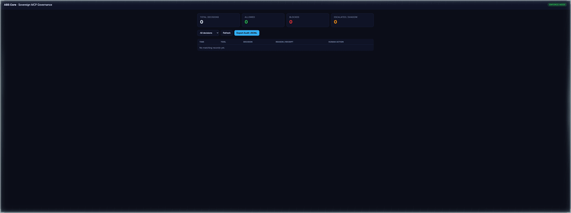

# ABS Core Gateway — Deterministic `<1ms` Firewall & Receipts for AI Agents

[](https://www.npmjs.com/package/@oconnectortech/mcp-gateway)
[](https://pypi.org/project/abs-core/)
[](LICENSE)

**ABS Core Gateway** is the open-core, deterministic runtime governance & cryptographic receipt layer for **Model Context Protocol (MCP)** servers and AI Agents (**Claude Desktop, Cursor, Windsurf, Claude Code, LangGraph, OpenAI Agents, Vercel AI SDK**).

- **SI-001 (Evidence Precedes Action):** seals SHA-256 hash-chained receipts to disk **before** any tool executes.
- **SI-004 (Fail-Closed Default):** blocks denied or escalated tool calls in `<1ms` before reaching the upstream MCP server or tool handler.
- **Zero-LLM Guardrails:** pure deterministic policy evaluation — no LLM-as-a-judge latency, cost, or prompt-injection bypass.



---

## ⚡ 30-Second Quickstart

### 0. Run the 10-Attack Local Red-Team Benchmark
```bash
npx @oconnectortech/mcp-gateway redteam
# Score: 10/10 interdicted | P50: 0.095ms | P99: 1.712ms
```

### 1. Transparent MCP `stdio` Firewall (`wrap`)
Drop ABS Core in front of any MCP server in **Claude Desktop, Cursor, Windsurf, VS Code, or Claude Code** — zero code changes required:

```json
{
  "mcpServers": {
    "filesystem-guarded": {
      "command": "npx",
      "args": [
        "-y", "@oconnectortech/mcp-gateway@latest",
        "wrap", "--pack", "devsecops", "--",
        "npx", "-y", "@modelcontextprotocol/server-filesystem", "."
      ]
    }
  }
}
```
> Pass `--shadow` before `--` to observe and log `SHADOW_DENY` receipts without blocking during initial rollout.

### 2. Built-in Policy Packs & Local Visual Dashboard (`GET /ui`)
```bash
npx @oconnectortech/mcp-gateway init --pack devsecops   # or fintech-pix | lgpd-health
npx @oconnectortech/mcp-gateway serve --port 8787       # opens http://127.0.0.1:8787/ui
```

### 3. Python 1-Line Tool Guard (`pip install abs-core`)
Zero-daemon local enforcement for LangChain, LangGraph, CrewAI, OpenAI Agents, PydanticAI, and plain Python functions:

```python
from abs_sdk import guard_tools

tools = guard_tools(tools, pack="devsecops")  # blocks system.exec, .env reads, rm -rf /
```

### 4. TypeScript 1-Line Tool Guard (Vercel AI SDK / Node)
```ts
import { wrapTools } from '@oconnectortech/mcp-gateway';

const tools = wrapTools({ readFile, execShell }, { pack: 'devsecops' });
```

### 5. GitHub Actions PR Gatekeeper
```yaml
- uses: eusheriff/abs-core-gateway@v6
```

---

## Open-Core vs. Enterprise Edition

| Capability | Open-Core (MIT — this repo) | ABS Core Enterprise (`eusheriff.me`) |
| :--- | :---: | :---: |
| Transparent MCP `stdio` proxy (`wrap`) & `--shadow` | ✅ | ✅ |
| Built-in `devsecops`, `fintech-pix`, `lgpd-health` packs | ✅ | ✅ |
| Local Visual Dashboard (`GET /ui`) & NDJSON hash-chain | ✅ | ✅ |
| 1-Line Python (`guard_tools`) & TS (`wrapTools`) wrappers | ✅ | ✅ |
| 10-Vector Local Red-Team Scorecard (`redteam`) | ✅ | ✅ |
| 11-Gate Rust/WASM SIL Engine + Multi-Agent CORTEX | — | ✅ |
| Ed25519 HSM/PKCS#11 Signing & RFC 3161 TSA Anchoring | — | ✅ |
| M-of-N Human Quorum (Passkey / Slack / Teams / WhatsApp) | — | ✅ |
| Regulated BACEN / LGPD / SOC 2 Audit Packs & 24/7 SLA | — | ✅ |

For Enterprise pilots (30-day shadow/enforce deployment) or advisory: **[eusheriff.me](https://eusheriff.me)** · `ceo@oconnector.com.br`
